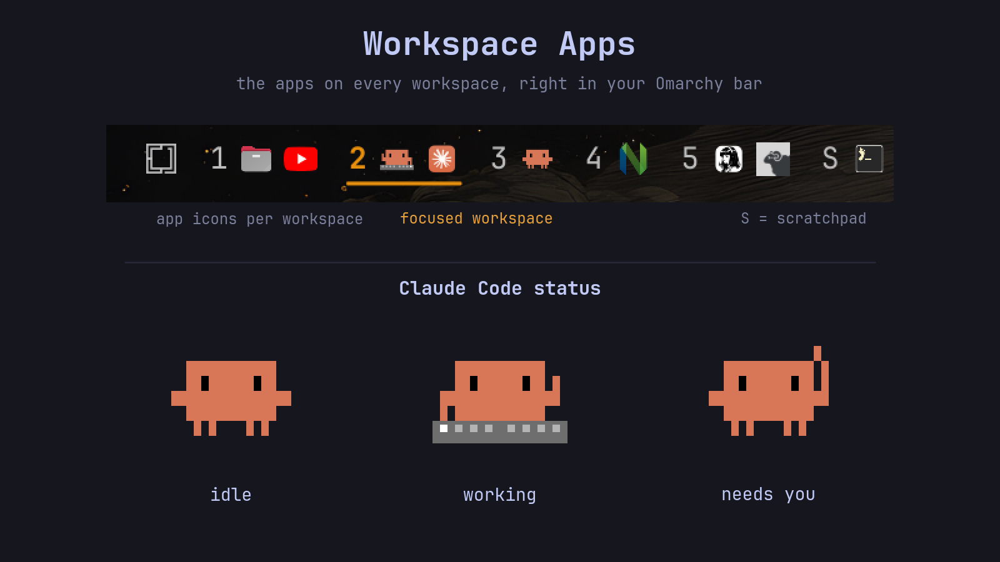
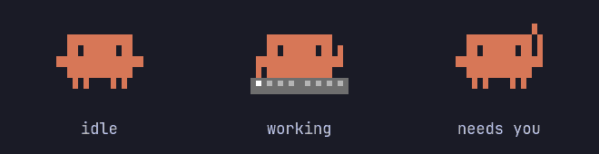

# Workspace Apps

An [Omarchy](https://omarchy.org/) bar widget that shows which apps are open on each workspace, so you never lose track of a window again.



- **App icons per workspace.** Each workspace number is followed by small icons of the windows open on it. Omarchy web apps get the icon of their launcher.
- **Scratchpad group.** Windows parked with `Super + S` show up under an **S** at the end, so they're never out of sight. The group hides itself when the scratchpad is empty.
- **Current workspace in your theme's accent colour.** The number stays readable instead of being replaced by a glyph, and the colour follows your theme.
- **Claude Code gets its mascot.** Terminals running [Claude Code](https://claude.com/claude-code) show the little Claude Code guy instead of a terminal icon, also when Claude Code runs inside tmux. With the [optional hooks](#claude-code-status) it also shows what Claude Code is doing: it types on a keyboard while working, waves when it needs your input, and stands still when it's idle.
- **Hermes too.** With [optional hooks](#hermes-status), the [Hermes](https://github.com/NousResearch/hermes-agent) icon turns orange and pulses while Hermes works, and turns red while it waits for you.
- **Workspaces past 10.** Workspaces 1–5 are always shown, and any other workspace in use appears too, including 11 and up.

Click a workspace number to switch to it, or click an app icon to jump straight to that window. For scratchpad icons it opens the scratchpad first. Hover an icon to see the window title, and click **S** to toggle the scratchpad.

## Install

```bash
omarchy plugin add https://github.com/Almorus/omarchy-workspace-apps
omarchy plugin enable almorus.workspace-apps --after omarchy.workspaces
omarchy plugin disable omarchy.workspaces
```

This puts the widget where the stock workspace numbers were and turns the stock ones off.

To go back:

```bash
omarchy plugin enable omarchy.workspaces --after almorus.workspace-apps
omarchy plugin disable almorus.workspace-apps
```

Update with `omarchy plugin update almorus.workspace-apps`.

If the bar doesn't pick up a change, run `omarchy restart shell`.

## Claude Code status



The mascot can show what each Claude Code session is doing, so you can see from any workspace which session is busy and which one is waiting for you. Claude Code reports that through [hooks](https://docs.claude.com/en/docs/claude-code/hooks), so add these to the `hooks` section of `~/.claude/settings.json` (create the section if it's missing):

```json
"hooks": {
  "UserPromptSubmit": [{ "hooks": [{ "type": "command", "timeout": 5, "command": "f=\"$HOME/.config/omarchy/plugins/almorus.workspace-apps/claude-status.sh\"; [ ! -f \"$f\" ] || sh \"$f\" working" }] }],
  "PostToolUse": [{ "matcher": "*", "hooks": [{ "type": "command", "timeout": 5, "command": "f=\"$HOME/.config/omarchy/plugins/almorus.workspace-apps/claude-status.sh\"; [ ! -f \"$f\" ] || sh \"$f\" working" }] }],
  "PostToolUseFailure": [{ "matcher": "*", "hooks": [{ "type": "command", "timeout": 5, "command": "f=\"$HOME/.config/omarchy/plugins/almorus.workspace-apps/claude-status.sh\"; [ ! -f \"$f\" ] || sh \"$f\" working" }] }],
  "PreToolUse": [{ "matcher": "AskUserQuestion|ExitPlanMode", "hooks": [{ "type": "command", "timeout": 5, "command": "f=\"$HOME/.config/omarchy/plugins/almorus.workspace-apps/claude-status.sh\"; [ ! -f \"$f\" ] || sh \"$f\" input" }] }],
  "PermissionRequest": [{ "matcher": "*", "hooks": [{ "type": "command", "timeout": 5, "command": "f=\"$HOME/.config/omarchy/plugins/almorus.workspace-apps/claude-status.sh\"; [ ! -f \"$f\" ] || sh \"$f\" input" }] }],
  "Notification": [{ "matcher": "permission_prompt|elicitation_dialog", "hooks": [{ "type": "command", "timeout": 5, "command": "f=\"$HOME/.config/omarchy/plugins/almorus.workspace-apps/claude-status.sh\"; [ ! -f \"$f\" ] || sh \"$f\" input" }] }],
  "Stop": [{ "hooks": [{ "type": "command", "timeout": 5, "command": "f=\"$HOME/.config/omarchy/plugins/almorus.workspace-apps/claude-status.sh\"; [ ! -f \"$f\" ] || sh \"$f\" idle" }] }],
  "StopFailure": [{ "hooks": [{ "type": "command", "timeout": 5, "command": "f=\"$HOME/.config/omarchy/plugins/almorus.workspace-apps/claude-status.sh\"; [ ! -f \"$f\" ] || sh \"$f\" idle" }] }],
  "SessionStart": [{ "hooks": [{ "type": "command", "timeout": 5, "command": "f=\"$HOME/.config/omarchy/plugins/almorus.workspace-apps/claude-status.sh\"; [ ! -f \"$f\" ] || sh \"$f\" idle" }] }],
  "SessionEnd": [{ "hooks": [{ "type": "command", "timeout": 5, "command": "f=\"$HOME/.config/omarchy/plugins/almorus.workspace-apps/claude-status.sh\"; [ ! -f \"$f\" ] || sh \"$f\" idle" }] }]
}
```

| The mascot… | when Claude Code… |
|---|---|
| types on a keyboard | works on your message or runs a tool |
| raises its hand and waves | asks for permission, asks you a question, or wants a plan approved |
| stands still | has finished, was interrupted, or hasn't started |

Each hook checks that the script is there first, so removing the plugin leaves them doing nothing. Open Claude Code sessions may need a restart to pick the hooks up.

Without the hooks, the mascot still types while Claude Code works, because Claude Code puts a spinner (◐◑◒◓) at the start of the terminal title. The same goes for background sessions (`claude daemon`): their hooks run in the background service, which can't be traced to a window, so the terminal showing them falls back to the title. It can't wave in that case. If one terminal has several sessions (tmux), the most urgent one wins: waving, then typing. The status needs `jq`, which Omarchy ships.

## Hermes status

The Hermes icon can show what Hermes is doing: orange and gently pulsing while it works, red while it waits for you (an approval, a question or a sudo password), and normal when it's idle. Hermes reports that through its shell hooks, so add these to `~/.hermes/config.yaml`:

```yaml
hooks:
  pre_llm_call:
    - command: 'sh -c ''f=$HOME/.config/omarchy/plugins/almorus.workspace-apps/hermes-status.sh; [ ! -f "$f" ] || exec sh "$f" working'''
      timeout: 5
  post_tool_call:
    - command: 'sh -c ''f=$HOME/.config/omarchy/plugins/almorus.workspace-apps/hermes-status.sh; [ ! -f "$f" ] || exec sh "$f" working'''
      timeout: 5
  on_human_input_request:
    - command: 'sh -c ''f=$HOME/.config/omarchy/plugins/almorus.workspace-apps/hermes-status.sh; [ ! -f "$f" ] || exec sh "$f" input'''
      timeout: 5
  on_human_input_resolved:
    - command: 'sh -c ''f=$HOME/.config/omarchy/plugins/almorus.workspace-apps/hermes-status.sh; [ ! -f "$f" ] || exec sh "$f" working'''
      timeout: 5
  on_session_end:
    - command: 'sh -c ''f=$HOME/.config/omarchy/plugins/almorus.workspace-apps/hermes-status.sh; [ ! -f "$f" ] || exec sh "$f" idle'''
      timeout: 5
  agent_loop_stopped:
    - command: 'sh -c ''f=$HOME/.config/omarchy/plugins/almorus.workspace-apps/hermes-status.sh; [ ! -f "$f" ] || exec sh "$f" idle'''
      timeout: 5
```

Hermes only runs a new hook after you've approved it, and it asks only in a terminal: run `hermes chat` once and accept the six hooks (or add them to `~/.hermes/shell-hooks-allowlist.json`). `hermes hooks list` shows whether they're approved. New Hermes chats pick them up; restart the Hermes gateway if it was already running.

Each hook checks that the script is there first, so removing the plugin leaves them doing nothing.

## How it works

- Workspaces and their windows come from Quickshell's Hyprland integration, the same data the stock widget uses.
- Icons are looked up from your installed desktop entries and icon theme. Apps whose window class doesn't match their desktop entry (Hermes reports `com.nousresearch.hermes`, but its entry is `hermes-desktop`) are matched by the last part of the class against each entry's id, `StartupWMClass`, program and name, exactly and ignoring case. A window without a matching desktop entry gets a generic app icon.
- Claude Code runs inside an ordinary terminal, so `agent-scan.sh` checks which windows have a `claude` process under them. For Claude Code inside tmux, it finds the terminal attached to that tmux session. It rechecks when windows open or close, and every 5 seconds. That's one `ps` and one `hyprctl clients` call, plus two quick `tmux` calls if tmux is installed.
- Only terminal windows (foot, Alacritty, kitty, Ghostty, WezTerm) get the mascot, so apps that start Claude Code themselves, such as Claude Desktop or an editor, keep their own icon.
- The hooks run `claude-status.sh` or `hermes-status.sh`, which write one line per Claude Code session or Hermes process to `$XDG_RUNTIME_DIR/agent-status/` (in memory, gone after a reboot), and only when the state actually changes. They never print anything and always exit successfully, so they can't block Claude Code or Hermes. The widget watches that folder and rescans within about half a second. Files left by sessions that crashed are removed on the next scan.
- Hermes runs its agents in a background gateway rather than under its window, so the widget shows one state for Hermes as a whole: the most urgent of any running Hermes process. The tint uses Qt's `MultiEffect`, and the pulse steps through a few levels about 7 times a second instead of redrawing every frame.
- Pressing Esc in Claude Code runs no hook, so the scan also checks the end of a working session's transcript: if it was interrupted, the mascot goes back to idle within 5 seconds.
- The animation timers only run while something is working or waiting.
- Workspaces are updated in place, so switching workspaces or opening a window doesn't redraw the whole widget or close an open tooltip.
- The scratchpad is Omarchy's default `special:scratchpad`.

## License

MIT. The Claude Code mascot icon is a pixel-art drawing of the character shown in Claude Code's welcome screen; Claude and Claude Code are trademarks of Anthropic.
